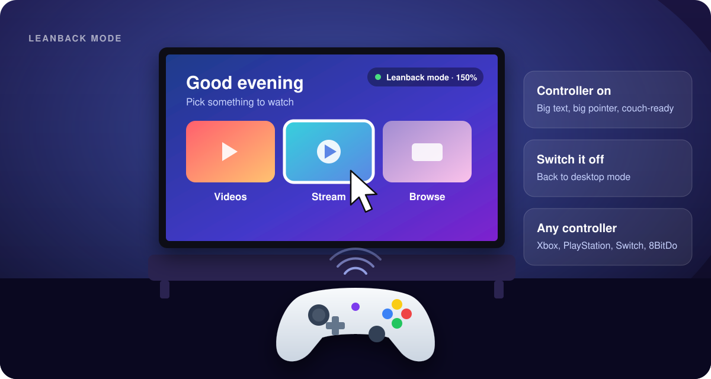
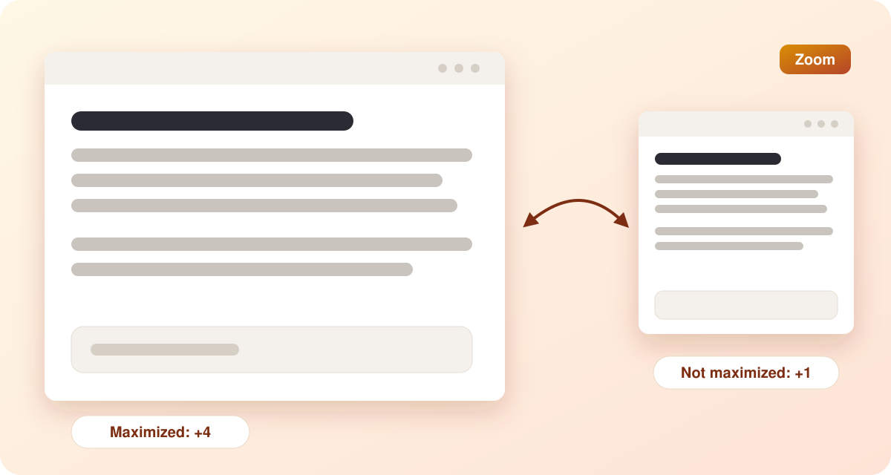

<p align="center">
  
</p>

<h1 align="center">Windows Unlocked Toolkit</h1>

<p align="center">
  <b>The little Windows fixes you've been missing.</b><br>
  Tiny, friendly, open-source tools that smooth out the everyday annoyances.<br>
  Pick the ones you like, skip the rest, remove any of them in a click.
</p>

<p align="center">
  <a href="https://2wanderingcrows.github.io/windows-unlocked-toolkit/WindowsUnlockedToolkit.cmd"><b>Download the toolkit</b></a>
  &nbsp;·&nbsp;
  <a href="https://2wanderingcrows.github.io/windows-unlocked-toolkit">Website</a>
  &nbsp;·&nbsp;
  <a href="#meet-the-toolkit">See what's inside</a>
</p>

<p align="center">
  
  
  
  
</p>

<!-- MOCKUP: illustration of the tray app. Replace site/assets/hero.svg with a real screenshot (1200x680). -->
<p align="center">
  
</p>
<p align="center"><sub>The toolkit's tray menu (illustration). One icon, every tool.</sub></p>

## Why you'll like it

Windows is great, but it has a lot of small "why can't it just..." moments.
This toolkit is a collection of fixes for exactly those moments. Each tool
does one job, does it well, and then gets out of your way.

|   |   |
| --- | --- |
| 🔒 **Private by design** | The tools never go online and never read what you type. Everything stays on your PC. |
| 📖 **Readable, not mysterious** | No hidden programs. Every tool is plain source code, built on your PC by the compiler that already ships with Windows. |
| ↩️ **Undo anytime** | Every tool has its own uninstaller that puts things back the way they were. |
| 🪶 **Light as a feather** | Small background helpers that start with Windows and don't need admin rights unless they say so. |
| 🎁 **Actually free** | No account, no ads, no "upgrade to Pro". MIT licensed. |

## Meet the toolkit

### 🛋️ Leanback Mode: your PC, now a couch console

<!-- MOCKUP: illustration. Replace site/assets/leanback.svg with a real photo or screenshot (1200x640) when one exists. -->


Using a PC on the TV is clumsy: tiny text, a pointer you can't find, and a
keyboard you don't want on your lap. **Leanback Mode** notices when you pick
up a controller and rearranges Windows for the couch.

- ✅ Switches to Leanback mode the moment your controller turns on, and back to desktop mode when you switch it off
- ✅ Controller dozed off mid-movie? You stay in Leanback mode until you turn it off yourself
- ✅ Bigger text and a pointer you can actually see from across the room
- ✅ Sticks move and scroll, buttons click, go back and open Start
- ✅ Steps aside on its own when you launch a game
- ✅ Works with Xbox, PlayStation, Switch Pro, 8BitDo and generic Bluetooth or 2.4 GHz pads

**Perfect for:** a PC plugged into the living-room TV, watching videos from bed, or anyone who'd rather hold a controller than a mouse.
[How it works and settings →](tools/leanback)

### 🎵 Media Tab Jump: who's making that noise? Found it.

<!-- MOCKUP: illustration. Replace site/assets/mediatabjump.svg with a real screenshot (1200x640) when one exists. -->


Thirty tabs open and something is playing. Windows shows you *what* is
playing, but not *where*. **Media Tab Jump** turns the player in the volume
flyout into a shortcut straight to the right tab.

- ✅ Click the now-playing card and land on the exact tab, even in another window
- ✅ Works with Edge, Chrome, Brave, Firefox, Opera and Vivaldi
- ✅ A soft, color-shifting glow tells you the card is clickable
- ✅ Play, pause and skip buttons keep working like always
- ✅ No browser extension, nothing to sign in to

**Perfect for:** tab hoarders, podcast listeners, and anyone who's ever hunted for the tab that started playing an ad.
[How it works →](tools/mediatabjump)

### 🔍 AutoZoom: every app at a comfortable size

<!-- MOCKUP: illustration. Replace site/assets/autozoom.svg with a real screenshot (1200x640) when one exists. -->


An app that looks great full-screen can feel cramped in half the screen, and
the other way round. **AutoZoom** lets you pick how zoomed in each app is when
its window is maximized and when it isn't, and switches by itself as you resize.

- ✅ Any app that zooms with Ctrl and +: Claude, Teams, Discord, Slack, VS Code, Notepad, browsers
- ✅ Two levels per app: one for maximized, one for everything else
- ✅ Each window keeps its own zoom, so two windows of the same app never fight
- ✅ Add apps and set their zoom from the tray app, with changes applied instantly
- ✅ Never reads the screen or what you type: it only presses the app's own zoom keys

**Perfect for:** anyone who snaps windows side by side, switches between a laptop screen and a big monitor, or runs two accounts of the same app.
[How it works →](tools/autozoom)

### 🎛️ Toolkit tray app: every tool, one tidy tray icon

Small helpers are great until you have five tray icons and five settings
files. The **toolkit tray app** puts every tool behind one icon.

- ✅ Click once to flip between Leanback mode and desktop mode, or turn any tool on or off
- ✅ Tune controller speed, scrolling and what every button does, without touching a config file
- ✅ Pick the hover glow's colour, brightness and size, with a live preview
- ✅ Choose which apps AutoZoom handles and how big each one gets
- ✅ Light or dark, your Windows accent or one of nine colours, three tray icon styles
- ✅ Pause everything for an hour when you need a plain PC

[How it works →](tools/toolkit)

### 🛠️ On the workbench

These are being polished and will join the same installer when they're ready:

- **Window Tab Organizer**: for anyone with way too many windows open
- **Startup Minimizer**: sign in to a calm desktop, not a pile of windows

Have an idea for a tool? [Open an issue](https://github.com/2wanderingcrows/windows-unlocked-toolkit/issues) and say what bugs you.

## Install in a minute

1. **Download** [`WindowsUnlockedToolkit.cmd`](https://2wanderingcrows.github.io/windows-unlocked-toolkit/WindowsUnlockedToolkit.cmd). It's one small file with every tool inside.
2. **Double-click it.** If Windows says it's from an unknown publisher, choose **More info**, then **Run anyway**. (That warning appears for any file without a paid signing certificate.)
3. **Pick your tools** from the menu. Run the file again any time and press **U** to uninstall one.

**Prefer the terminal?** Paste this into PowerShell for the same menu:

```powershell
irm https://2wanderingcrows.github.io/windows-unlocked-toolkit/install.ps1 | iex
```

**Want just one tool?** Open its folder under [`tools/`](tools), download it,
and run its `Install.cmd`.

The installer holds each tool's full source. The only thing it downloads is
AntiMicroX (with `winget`), and only if you pick Leanback Mode and don't have
it yet. Some tools are built on your PC with the C# compiler that comes with
Windows, so antivirus or Smart App Control may ask about them the first time.

## Questions

<details>
<summary><b>Is it safe?</b></summary>

Everything is open source, so you (or a techy friend) can read exactly what
each tool does. Nothing is pre-compiled: the tools are built from that source
on your own PC. They don't connect to the internet, and they only use standard
Windows features, like the accessibility tools screen readers rely on.
</details>

<details>
<summary><b>How do I remove a tool?</b></summary>

Run the installer again and press **U**, or open the tool's folder and
double-click `Uninstall.cmd`. Settings it changed (like display scaling) go
back to how they were.
</details>

<details>
<summary><b>Will it slow my PC down?</b></summary>

No. The tools are small background helpers that mostly sleep until you need
them. You can see and pause them in Task Manager under Startup apps.
</details>

<details>
<summary><b>Something isn't working. Where do I look?</b></summary>

Each tool keeps a small log in its folder (the tool's own README says where).
[Open an issue](https://github.com/2wanderingcrows/windows-unlocked-toolkit/issues)
with the last few lines and it'll get looked at.
</details>

## How this repo works

- Every tool lives in its own folder in [`tools/`](tools), with a `tool.json`
  describing it.
- On every change to `main`, [GitHub Actions](.github/workflows/build.yml) runs
  [`scripts/build.py`](scripts/build.py), which packs every tool into one
  installer and rebuilds the website. Nobody edits the combined installer by
  hand, so it can't fall out of date.
- The website is [`site/index.template.html`](site/index.template.html). Each
  tool's pitch on it (tagline, highlights, picture) comes from
  [`site/showcase.json`](site/showcase.json), and the pictures live in
  [`site/assets/`](site/assets). Pictures marked as mockups are illustrations;
  swap in real screenshots at the same size and set `"mockup": false`.

## License

[MIT](LICENSE). Use it, change it, share it.

<p align="center"><sub>Made with care, and a lot of help from Claude.</sub></p>
