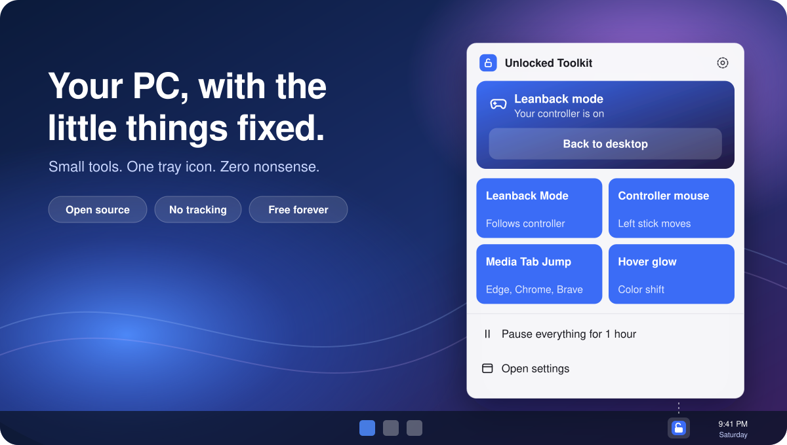
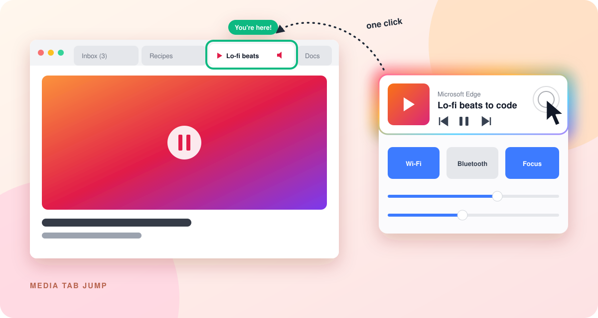

<p align="center">
  
</p>

<h1 align="center">Windows Unlocked Toolkit</h1>

<p align="center">
  <b>The little Windows fixes you've been missing.</b><br>
  Tiny, friendly, open-source tools. Pick what you like, skip the rest.
</p>

<p align="center">
  <a href="https://2wanderingcrows.github.io/windows-unlocked-toolkit/WindowsUnlockedToolkitSetup.exe"><b>Download the toolkit</b></a>
  &nbsp;·&nbsp;
  <a href="https://2wanderingcrows.github.io/windows-unlocked-toolkit">Website</a>
  &nbsp;·&nbsp;
  <a href="#meet-the-toolkit">See what's inside</a>
</p>

<p align="center">
  
  
  
  
</p>

<!-- MOCKUP: illustration of the tray app. Replace site/assets/hero.svg with a real screenshot (1200x680). -->
<p align="center">
  
</p>
<p align="center"><sub>The toolkit's tray menu (illustration). One icon, every tool.</sub></p>

🔒 Private (only the update check goes online) · 📖 Plain source, built on your PC · ↩️ Removes cleanly · 🔄 Updates itself · 🎁 Free, MIT

## Meet the toolkit

Click a tool to see what it does.

<details>
<summary><b>🛋️ Leanback Mode</b>: your PC, now a couch console.</summary>


Pick up a controller and Windows rearranges itself for the couch. Put it down and your desktop is back.

- Turns on with your controller, off when you switch it off
- Bigger text and a pointer you can see across the room
- **Hold Y for a fast pointer** that crosses a big TV in a blink
- Hold LT and tilt the right stick for volume or window switching
- **Plays nice with Playnite, Steam Big Picture and Kodi**, handing them the controls while they're in front
- **Map any button** to a key combo, or to open an app
- **Finds every button on your controller**: Home, D-pad, paddles and extras
- Steps aside on its own when a game starts
- Monitor and TV? Only the screen you pick gets bigger
- Xbox, PlayStation, Switch Pro, 8BitDo and generic Bluetooth or 2.4 GHz pads

[Details and settings →](tools/leanback)
</details>

<details>
<summary><b>🎵 Media Tab Jump</b>: who's making that noise? Found it.</summary>



Something's playing in one of thirty tabs. Click the player in the volume flyout and land right on it.

- Jumps to the exact tab, even in another window or screen
- Edge, Chrome, Brave, Firefox, Opera and Vivaldi
- A soft glow shows the card is clickable
- Play, pause and skip work like always
- No browser extension, nothing to sign in to

[Details and settings →](tools/mediatabjump)
</details>

<details>
<summary><b>🔍 AutoZoom</b>: every app at a comfortable size.</summary>


Set how zoomed in each app is when maximized and when not. AutoZoom switches as you resize.

- Any app that zooms with Ctrl and +: Claude, Teams, Discord, VS Code, browsers
- Each window keeps its own zoom
- Different levels per screen, switching as you drag across
- Set it all from the tray app, applied instantly
- Only presses the app's own zoom keys, never reads the screen

[Details and settings →](tools/autozoom)
</details>

<details>
<summary><b>🎛️ Toolkit tray app</b>: every tool, one tidy tray icon.</summary>


Every tool behind one tray icon, with quick switches and a settings page for each.

- One click between Leanback and desktop mode
- Controller speed, buttons and key combos without config files
- Glow colours and AutoZoom levels with live preview
- Light or dark, nine accent colours, three icon styles
- Pause everything for an hour

[Details and settings →](tools/toolkit)
</details>

**On the workbench:** Window Tab Organizer, Startup Minimizer.
Have an idea? [Open an issue](https://github.com/2wanderingcrows/windows-unlocked-toolkit/issues).

## Install in a minute

1. **Download** [`WindowsUnlockedToolkitSetup.exe`](https://2wanderingcrows.github.io/windows-unlocked-toolkit/WindowsUnlockedToolkitSetup.exe).
2. **Open it.** If Windows says it "protected your PC", choose **More info**, then **Run anyway**.
3. **Pick your tools and press Install.** No admin rights needed.

New versions then install themselves quietly while you're away, keeping your
settings. Turn that off in the tray app under **Updates and about**. Every
version is also on the [Releases page](https://github.com/2wanderingcrows/windows-unlocked-toolkit/releases).

<details>
<summary>Other ways to install</summary>

Paste this into PowerShell for a text menu:

```powershell
irm https://2wanderingcrows.github.io/windows-unlocked-toolkit/install.ps1 | iex
```

Or download [`WindowsUnlockedToolkit.cmd`](https://2wanderingcrows.github.io/windows-unlocked-toolkit/WindowsUnlockedToolkit.cmd), the same menu as a file.
For one tool only, open its folder under [`tools/`](tools) and run `Install.cmd`.
</details>

## Questions

<details>
<summary><b>Is it safe?</b></summary>

Everything is open source, so you (or a techy friend) can read exactly what
each tool does. Nothing is pre-compiled: the tools are built from that source
on your own PC. The tools themselves don't connect to the internet, and they
only use standard Windows features, like the accessibility tools screen readers
rely on. The tray app's update check downloads two files from this project's
website, `manifest.ini` (the version list) and, when there's an update,
`install.ps1` (the same installer as above), and nothing else.
</details>

<details>
<summary><b>How do I remove a tool?</b></summary>

Open **Settings > Apps**, find **Windows Unlocked Toolkit** and choose
**Uninstall** to pick what to remove. Or run the setup again and choose
**Remove tools**, or open the tool's folder and double-click `Uninstall.cmd`. Settings it changed (like display scaling) go
back to how they were.
</details>

<details>
<summary><b>What does the installer download?</b></summary>

Only AntiMicroX (with `winget`), and only if you pick Leanback Mode and don't
have it. Everything else is source code built on your PC, so antivirus or
Smart App Control may ask about it the first time.
</details>

<details>
<summary><b>Will it slow my PC down?</b></summary>

No. The tools are small background helpers that mostly sleep until you need
them. You can see and pause them in Task Manager under Startup apps.
</details>

<details>
<summary><b>Something isn't working. Where do I look?</b></summary>

Each tool keeps a small log in its folder (the tool's own README says where).
[Open an issue](https://github.com/2wanderingcrows/windows-unlocked-toolkit/issues)
with the last few lines and it'll get looked at.
</details>

## How this repo works

<details>
<summary>For contributors</summary>

- Every tool lives in its own folder in [`tools/`](tools), with a `tool.json`
  describing it.
- On every change to `main`, [GitHub Actions](.github/workflows/build.yml) runs
  [`scripts/build.py`](scripts/build.py), which packs every tool into one
  installer and rebuilds the website. Nobody edits the combined installer by
  hand, so it can't fall out of date.
- The setup app ([`setup/`](setup)) is built on Windows by
  [`scripts/build-setup.ps1`](scripts/build-setup.ps1) around that installer.
  When a tool's version changes, the workflow also publishes a
  [release](https://github.com/2wanderingcrows/windows-unlocked-toolkit/releases)
  with it, and the website's `manifest.ini` tells installed tray apps to update.
- The website is [`site/index.template.html`](site/index.template.html). Each
  tool's pitch on it (tagline, highlights, picture) comes from
  [`site/showcase.json`](site/showcase.json), and the pictures live in
  [`site/assets/`](site/assets). Pictures marked as mockups are illustrations;
  swap in real screenshots at the same size and set `"mockup": false`.
</details>

## Friends

- **[The Haugen Project](https://thehaugenproject.com/)**: the world at a
  glance, made at home with no ads or tracking. A history atlas, a live
  California and Oregon outage board, quizzes, and browser games.

## License

[MIT](LICENSE). Use it, change it, share it.

<p align="center"><sub>Made with care, and a lot of help from Claude.</sub></p>
